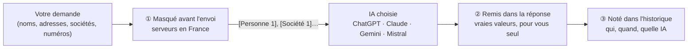

<div align="center">


# MASKAI

### Ce qui est sensible devient invisible.

**L'espace de travail IA confidentiel** — ChatGPT, Claude, Gemini et Mistral dans un espace sécurisé.

<br/>

[](https://maskai.fr/essai-gratuit)
[](https://maskai.fr/vos-donnees)
[](https://maskai.fr/confidentialite)

[**Essai gratuit 7 jours**](https://maskai.fr/essai-gratuit) · [Réserver une démonstration](https://maskai.fr/contact) · [maskai.fr](https://maskai.fr)

</div>

---

## Ce que fait MASKAI

MASKAI est un espace de travail IA français qui **masque les données sensibles avant l'envoi** à ChatGPT, Claude, Gemini ou Mistral, puis **restaure les vraies valeurs dans la réponse**, visibles par l'utilisateur seul. Le masquage est réalisé sur des serveurs en France.

```diff
  Ce que vous écrivez
- Résume les trois pièces et dis-moi si Karim Benali peut contester le licenciement notifié par Transports Roche SAS.

  Ce que l'IA reçoit
+ Résume les trois pièces et dis-moi si [Personne 1] peut contester le licenciement notifié par [Société 1].
```

<sub>Exemple, données fictives.</sub>

---

## Le masque, en trois étapes



| | Étape | Ce qui se passe |
|:-:|---|---|
| **1** | **Masqué avant l'envoi** | Noms, adresses, sociétés et numéros sont remplacés par des pseudonymes numérotés. Le même pseudonyme reste stable du début à la fin de la conversation : l'IA suit le dossier sans recevoir les données sensibles. |
| **2** | **Remis dans la réponse** | Les vraies valeurs reviennent dans la réponse de l'IA, visibles par l'utilisateur seul. |
| **3** | **Noté dans l'historique** | Chaque envoi est tracé : qui, quand, vers quelle IA, combien d'éléments masqués. |

---

## Fonctionnalités

<table>
  <tr>
    <td width="50%" valign="top">
      <h3>🔒 Masquage à chaque message</h3>
      Pseudonymisation au sens du RGPD, appliquée automatiquement avant tout envoi à l'IA.
    </td>
    <td width="50%" valign="top">
      <h3>🤖 Les grandes IA, un seul espace</h3>
      ChatGPT (OpenAI), Claude (Anthropic), Gemini (Google) et Mistral (Mistral AI). Votre organisation choisit celles qu'elle autorise.
    </td>
  </tr>
  <tr>
    <td width="50%" valign="top">
      <h3>📄 Anonymiseur de documents</h3>
      PDF, Word, PowerPoint, Excel, CSV et texte (jusqu'à 25 Mo) : anonymiser (définitif), pseudonymiser (réversible), restaurer.
    </td>
    <td width="50%" valign="top">
      <h3>⚙️ Vos règles</h3>
      Vous choisissez les IA autorisées, les utilisateurs et l'offre de chacun.
    </td>
  </tr>
  <tr>
    <td width="50%" valign="top">
      <h3>🇫🇷 Hébergé en France</h3>
      Le masquage se fait en France : les vraies valeurs ne quittent pas le territoire.
    </td>
    <td width="50%" valign="top">
      <h3>🎙️ Transcription <sub>bientôt</sub></h3>
      Vous dictez, MASKAI écrit et masque les données, comme toujours.
    </td>
  </tr>
</table>

---

## Pour qui ?

Pour tous ceux qui travaillent avec des informations confidentielles :

**Cabinets d'avocats** · **Experts-comptables** · **Notaires** · **RH et recrutement** · **Dirigeants de PME**

> **Le secret professionnel, même avec l'IA.**
> Dans son guide déontologie et IA du 17 mars 2026, le Conseil national des barreaux recommande de *« pseudonymiser ou anonymiser systématiquement les données avant toute utilisation d'un outil d'IA générative »*. MASKAI applique ce geste à chaque message.
> → [Voir la page avocats](https://maskai.fr/pour-les-avocats)

---

## Offre bêta

<div align="center">

| Pendant la bêta (jusqu'au 31 décembre 2026) |
|:---:|
| **29 € HT** / utilisateur / mois — tout compris |
| Essai gratuit 7 jours, sans carte bancaire |

[**Commencer l'essai gratuit →**](https://maskai.fr/essai-gratuit)

<sub>À l'ouverture (1ᵉʳ janvier 2027) : Rempart, Bastion, Citadelle et Entreprise — détails sur <a href="https://maskai.fr/tarifs">maskai.fr/tarifs</a>.</sub>

</div>

---

## L'équipe

Une petite équipe à Lyon, un seul sujet : la confidentialité. MASKAI est né d'une question posée par des avocats : *« Comment utiliser l'IA sans lui confier les données sensibles de nos clients ? »* Le produit a été testé avec des cabinets d'avocats lyonnais pendant la bêta.

MASKAI est édité par **AXOR 2.0** (Limonest, Lyon, France).

→ [Rencontrer l'équipe](https://maskai.fr/a-propos)

---

<div align="center">

### Restons en contact

[](https://maskai.fr)
[](https://www.linkedin.com/company/maskai-fr/)
[](mailto:contact@maskai.fr)

[Fonctionnement](https://maskai.fr/fonctionnement) · [Documents](https://maskai.fr/documents) · [Vos données](https://maskai.fr/vos-donnees) · [Confidentialité](https://maskai.fr/confidentialite) · [Mentions légales](https://maskai.fr/mentions-legales)

<sub>© 2026 MASKAI · AXOR 2.0 · Lyon, France</sub>

</div>
